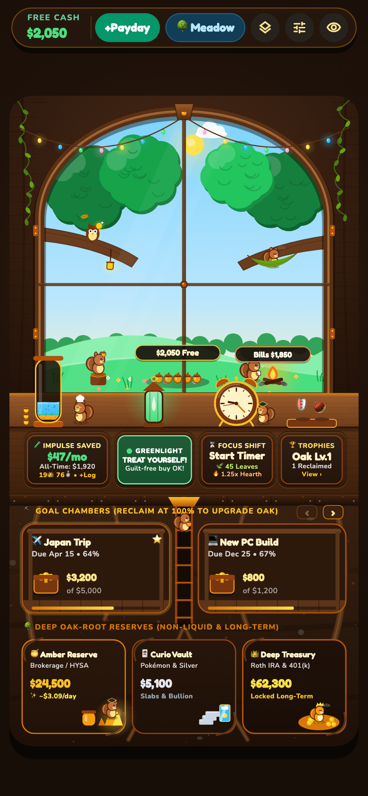
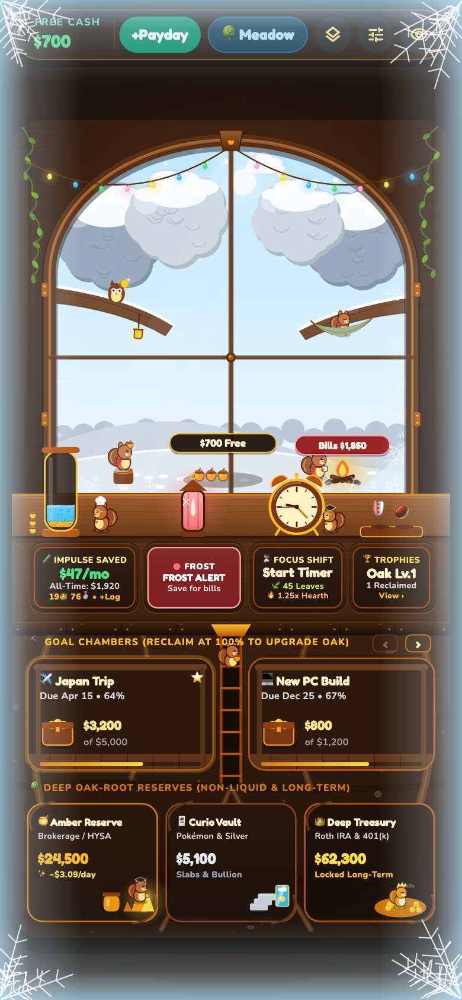
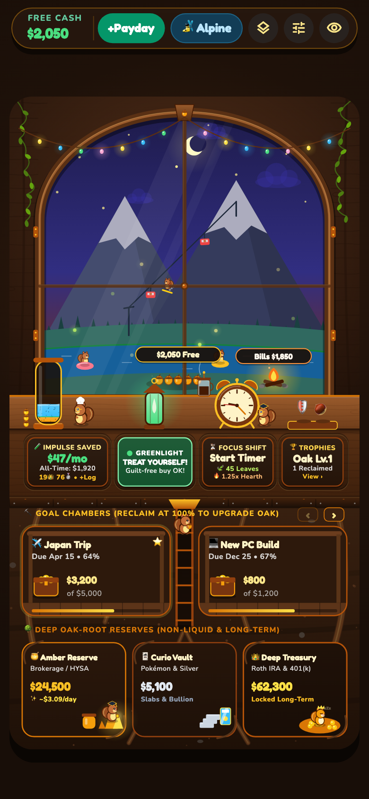
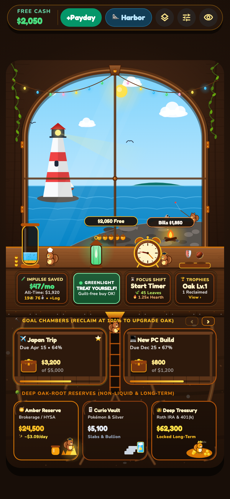

# SquirrelStash 🌰

A cozy, passive-simulation personal finance tracker and ambient focus
companion. Your money lives in a living **Hollow Oak Study**: squirrels haul
acorns into goal chambers, frost creeps across the window when bills outpace
free cash, and a brass clock keeps you company during Focus Shifts.

Built with **Flutter + Flame + SQLite + Riverpod**. Offline-first: everything
stays on the device.

| Meadow | Frostline | Alpine twilight | Harbor |
|---|---|---|---|
|  |  |  |  |

## Run it
```bash
export PATH="$HOME/development/flutter/bin:$PATH"   # wherever Flutter lives
flutter pub get
flutter test
flutter run            # Android device/emulator (needs Android Studio once)
flutter run -d chrome  # quick browser preview (in-memory demo data)
```

- Engineering rules: `CLAUDE.md`
- Current status, folder tree, and next steps: `STATUS.md`
- Custom artwork: drop PNGs into `assets/images/rooms/`, `icons/`, `props/`, `outfitter/`,
  `metro/` or `assets/sprites/squirrels/` (see the JSON templates in each folder).

Fonts: Fredoka and Nunito, SIL Open Font License (see `assets/fonts/`).
